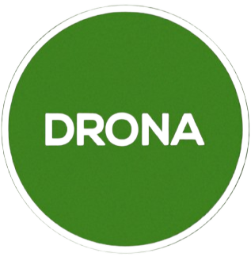

# Drona - Interactive Computer Science Visualization Platform

<div align="center">



**Master computer science concepts through interactive visualizations**

[](LICENSE)
[](https://github.com)
[](https://drona.com)
[](https://drona.com)

[Live Demo](https://drona.com) • [Documentation](PROJECT_DESCRIPTION.md) • [Report Bug](https://github.com/issues) • [Request Feature](https://github.com/issues)

</div>

---

## 🎯 Overview

**Drona** is a comprehensive, interactive visualization platform designed to revolutionize computer science education. Drona transforms abstract theoretical concepts into tangible, hands-on learning experiences through real-time visualizations, step-by-step animations, and interactive simulations.

### Key Features

- 🎨 **Interactive Visualizations** - Real-time algorithm execution with visual feedback
- 📚 **Comprehensive Coverage** - Data structures, algorithms, OS concepts, and AI
- 🎓 **Educational Excellence** - Step-by-step explanations and performance metrics
- 🆓 **100% Free** - No cost, no subscriptions, no ads
- 🔓 **Open Source** - Community-driven development
- 🔒 **Privacy-Focused** - No tracking, no data collection

## 🚀 Quick Start

```bash
# Install dependencies
npm install

# Start development server
npm run dev

# Build for production
npm run build
```

## 📖 What's Included

### Data Structures
- Arrays, Linked Lists (Single, Doubly, Circular)
- Stacks, Queues (including Circular and Priority Queues)
- Deques, Trees (Binary, BST, AVL), Graphs

### Algorithms
- **Sorting**: Bubble, Selection, Insertion, Merge, Quick Sort
- **Searching**: Linear Search, Binary Search
- **Optimization**: Knapsack, Job Sequencing

### Operating Systems
- **CPU Scheduling**: FCFS, SJF, Round Robin, Priority
- **Memory Management**: FIFO, LRU, MRU Page Replacement
- **Disk Scheduling**: SCAN, C-SCAN, LOOK, C-LOOK

### AI & Machine Learning
- K-Means Clustering, Decision Trees, Random Forest
- CNN, Logistic Regression, Hill Climbing, A*

### ECE Algorithms
- FFT, Viterbi Algorithm, Kalman Filter
- Turbo Codes, LDPC Codes, Modulation

## 🛠️ Technology Stack

- **Frontend**: React 18 + TypeScript + Vite
- **Styling**: Tailwind CSS + Radix UI
- **Backend**: Supabase (Authentication & Database)
- **Routing**: React Router
- **State Management**: React Context + TanStack Query

## 📚 Documentation

- [Project Description](PROJECT_DESCRIPTION.md) - Comprehensive project overview
- [Data Structures Reference](DATA_STRUCTURES_REFERENCE.md) - Complete API reference
- [Implementation Status](IMPLEMENTATION_STATUS.md) - Current development status

## 🌟 Features

### For Students
- Interactive learning with hands-on visualizations
- Step-by-step algorithm breakdowns
- Real-time performance metrics
- No registration required

### For Educators
- Embeddable visualizations
- Shareable direct links
- Comprehensive algorithm explanations
- Quiz generation system

## 🤝 Contributing

We welcome contributions! Whether it's:
- Adding new algorithm visualizations
- Improving existing visualizations
- Fixing bugs
- Enhancing documentation
- UI/UX improvements

See our [Contributing Guidelines](CONTRIBUTING.md) for more details.

## 📄 License

This project is open source. See [LICENSE](LICENSE) file for details.

## 👥 Team

Built with ❤️ by **Drona Team**

## 📞 Contact

- **Email**: support@drona.com
- **Website**: https://drona.com
- **GitHub**: [Drona Repository]

## 🙏 Acknowledgments

Drona aims to democratize computer science education and make learning algorithms and data structures accessible to students and educators worldwide.

---

<div align="center">

**Made with ❤️ in India** नमस्ते 🙏

[Website](https://drona.com) • [Documentation](PROJECT_DESCRIPTION.md) • [Support](mailto:support@drona.com)

</div>

